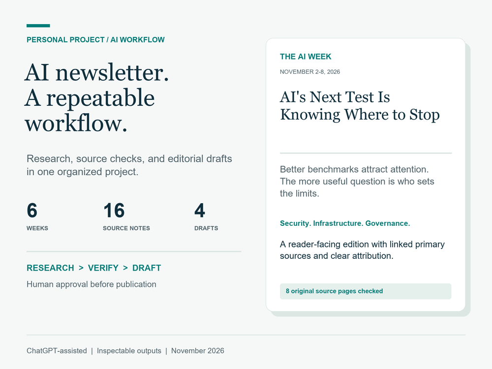

# AI-Assisted Newsletter Research & Editorial Workflow

A personal project that turns dated AI-news research into source-linked newsletter drafts using ChatGPT, reusable editorial instructions, and a structured Markdown archive.

## View the work

- **[Read the featured newsletter](portfolio/newsletter-sample.md)** - an edited portfolio edition covering November 2-8, 2026, checked against accessible primary sources on November 13.
- **[Open the portfolio PDF](portfolio/ai-newsletter-portfolio.pdf)** - a project overview and clean newsletter sample.
- **[Inspect the source checks](portfolio/source-checks.md)** - the evidence behind the featured edition and the limits of the review.

## What the project demonstrates

The workflow separates research collection, story selection, drafting, and publication approval. Sources stay attached to claims, company-reported results stay attributed, and internal research stays separate from reader-facing copy.

**Project role:** owner and director of a personal AI-assisted workflow, developed through iterative instructions and review. ChatGPT assists research, organization, drafting, and portfolio preparation. The included files make the method and outputs inspectable.

**Skills demonstrated:** prompt and workflow design, research organization, source tracing, editorial structure, and Markdown documentation.

## Evidence in the repository

Snapshot as of **November 13, 2026**:

| Evidence | Where to inspect it |
| --- | --- |
| Research organized across 6 project weeks | [Week index](Newsletter%20Template.md#weeks) |
| 16 dated source collections | Each `Week N/Sources/` folder |
| 4 complete weekly drafts | [Week 2](Week%202/Newsletter%20Draft.md), [Week 3](Week%203/Newsletter%20Draft.md), [Week 4](Week%204/Newsletter%20Draft.md), [Week 5](Week%205/Newsletter%20Draft.md) |
| Reusable research and editorial rules | [`_system/`](_system/) |
| A clean, source-checked portfolio edition | [Featured sample](portfolio/newsletter-sample.md) |

These are counts of existing files, not readership, revenue, or time-saving claims.

## How it works

1. **Collect:** the intended research cadence is Monday, Wednesday, and Friday at 5 PM Eastern. Research is saved in dated notes and compared with earlier collections to reduce duplication.
2. **Check and select:** inspect original sources, publication dates, significant figures, and attribution; distinguish announced plans from completed results.
3. **Draft:** the Sunday instructions call for a coherent newsletter with a clear introduction, selective stories, linked evidence, and a closing perspective.
4. **Approve:** drafts require human approval before publication. The repository does not automatically post issues to a website or email list.

## Explore the workflow

| File or folder | Purpose |
| --- | --- |
| [Newsletter Template.md](Newsletter%20Template.md) | Week index and reader-facing editorial standard |
| `Week N/Sources/` | Dated research collections |
| `Week N/Newsletter Draft.md` | Weekly editorial draft with source trail |
| [_system/routine-prompt.md](_system/routine-prompt.md) | Research instructions and file-update rules |
| [_system/issue-prompt.md](_system/issue-prompt.md) | Newsletter production instructions |
| [_system/sources.md](_system/sources.md) | Source-selection and verification policy |
| [portfolio/](portfolio/) | Featured edition, PDF, preview, and source-check record |
| [Tests/](Tests/) | Earlier standalone writing samples |

## Scope and current status

This is a **personal portfolio prototype** with inspectable research and drafting outputs. Research currently extends through Week 6; the latest complete weekly draft is Week 5. The featured portfolio edition was prepared separately and does not replace the historical draft.

The automation schedule is managed outside this repository. End-to-end unattended reliability, delivery time, readership, and business impact have not been measured. The featured edition received a fresh source check; the historical archive has not all been reverified for publication.

Project Week 1 begins **October 5, 2026**; weeks advance in seven-day intervals. Navigation uses standard GitHub Markdown links. Local Obsidian settings and plugins are ignored by Git.
